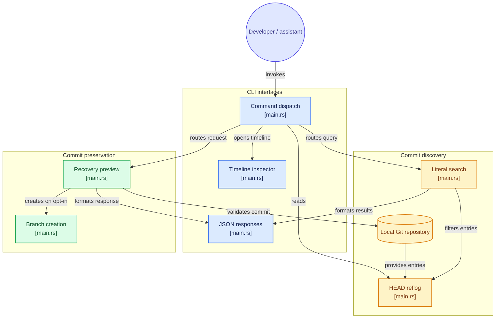

# git-panic


Find an earlier commit. Give it a branch. Decide what happens next.

I'm Aidan, the creator of git-panic and [Prism AI](https://github.com/DudeSquad999/Prism-Ai). I started this project after dealing with Git recovery while building Prism. git-panic is a local Git recovery CLI written in Rust. It helps you find an earlier commit and preserve it on a new branch without switching branches or changing working files.

[Install](#installation) · [Quick start](#quick-start) · [Commands](#command-reference) · [Beginner guide](docs/guide.md) · [Architecture](#architecture) · [Prism AI](#my-other-project-prism-ai) · [License](LICENSE)

## Why I built it

Git recovery can be confusing when you're trying to figure out what happened to your work. I built git-panic around a small workflow: inspect the history, review a commit, and explicitly choose whether to give it a new branch.

After a reset or rebase, a commit may still exist locally even when your branch no longer points to it. Git's HEAD reflog records where your current Git position has moved. git-panic makes those entries easier to browse and search.

This is not an automatic undo button. It preserves existing commits, not edits Git never saved. A recovery branch does not restore working files or back up uncommitted work.

## See it in action


Captured with [scripts/render-demo.sh](scripts/render-demo.sh) in a disposable practice repository. Commands are blue; output is white. The banner at the top is artwork, not a screenshot.

## What it does

| Feature | What you get |
| :--- | :--- |
| Read-only timeline | Browse HEAD reflog entries and inspect full commit SHAs. |
| Literal search | Filter reflog messages with case-insensitive text. |
| Preview first | Validate a commit and unused branch name without writing changes. |
| Explicit branch creation | Add `--create` after reviewing the target. Existing branches are never overwritten. |
| JSON output | Use search and recovery from scripts or shell-capable coding assistants. |
| Local operations | No checkout, reset, clean, stash, or remote operations. |


## Installation

You need Git, Rust 1.88 or newer with Cargo, and a native C compiler with platform build tools for vendored libgit2. Current stable Rust is recommended. OpenSSL development files are not required. The timeline needs an interactive terminal.

```sh
git clone https://github.com/DudeSquad999/git-panic.git
cd git-panic
cargo install --path . --locked
git-panic --help
```

Make sure Cargo's binary directory is on PATH:

| Platform | Directory |
| :--- | :--- |
| Linux / macOS | `~/.cargo/bin` |
| Windows | `%USERPROFILE%\.cargo\bin` |

Alternatively, run `cargo build --release --locked` and use `target/release/git-panic` (`git-panic.exe` on Windows).

`Cargo.toml` declares `rust-version = "1.88"`. The merged build-validation notes report successful builds and tests with 1.88.0; 1.87.0 could not resolve the committed dependencies. `Cargo.lock` is committed, and `--locked` uses that dependency resolution. No registry-install command is documented here.

Earlier installation and tutorial checks were documented on Linux with rustc 1.99.1. CI is configured for Linux, macOS, and Windows. Check the latest Actions results before assuming a particular revision passed. Builds may need internet access.

## Quick start

After installation, change into the repository you want to inspect, not the git-panic source checkout. Another clone may not have the same local reflog.

### 1. Find a commit

```sh
git-panic                 # Open the read-only timeline
git-panic reset           # Search messages containing "reset"
git-panic "commit: fix"   # Search a phrase containing spaces
```

Search is literal and case-insensitive, not natural-language interpretation or regular expressions. Copy a full 40-character commit SHA from a result. Quit the timeline before running recovery commands.

### 2. Preview preservation

This example uses a POSIX shell. Replace the placeholder with an actual commit SHA and choose an unused branch name.

```sh
SHA='<paste-full-40-character-commit-SHA>'
git-panic recover "$SHA" --branch panic/recovered
```

Preview validates the commit and branch name. It writes nothing and does not reserve the name.

### 3. Create the branch when ready

Review the preview before explicitly opting in:

```sh
git-panic recover "$SHA" --branch panic/recovered --create
```

Only the new branch reference is created. HEAD, the index, and working files stay unchanged. Inspecting or integrating files from that branch is a separate decision.

Start with the [disposable practice exercise](docs/guide.md#practice-without-risking-your-project) if you're new to recovery. The [full guide](docs/guide.md) includes PowerShell examples.

## Command reference

| Command | Behavior |
| :--- | :--- |
| `git-panic` or `git-panic tui` | Open the read-only HEAD reflog timeline. |
| `git-panic "query"` | Search reflog messages for a literal substring. |
| `git-panic --json "query"` | Return search results as JSON. |
| `git-panic recover <SHA> --branch <name>` | Preview preserving a commit on a new branch. |
| `git-panic recover <SHA> --branch <name> --create` | Create that branch without checking it out. |
| `git-panic recover <SHA> --branch <name> --json` | Return the preview as JSON; also works with `--create`. |
| `git-panic --help` / `git-panic --version` | Show help or version information. |

`recover` requires a full 40-character commit SHA, an available local commit, and a valid unused branch name. Abbreviated SHAs, moving references such as `HEAD@{0}`, non-commit objects, and the branch name `HEAD` are rejected.

`snapshot --before` is reserved but not implemented. It reports failure and is not a recovery option.

### Timeline controls

| Key | Action |
| :--- | :--- |
| Up / Down or `k` / `j` | Select an entry. |
| PageUp / PageDown | Move by ten entries. |
| Home / End | Jump to the newest / oldest entry. |
| `q` or Ctrl-C | Exit. |

The inspector shows the full SHA, reflog position, and action message. It is read-only. `R` does not restore anything. Use literal search instead of the TUI in redirected or captured shell tools. Search output can be piped to tools such as `head` or `grep -m`.

## Scripts and coding assistants

Use the installed CLI through an assistant's shell tool. git-panic supplies no plugin, MCP server, model key, or permission bypass.

```sh
git-panic --json reset
git-panic recover "$SHA" --branch panic/recovered --json
```

Search JSON includes `tool`, `query`, `match_count`, and `matches`. Each match contains `index`, `oid`, and `message`. Recovery JSON includes `tool`, `action`, `created`, `commit`, and `branch`.

- A completed search exits 0 even with no matches. Check `match_count`.
- Errors use human-readable stderr and a nonzero exit code.
- JSON is available for search and recovery, not the timeline.
- The documented JSON shape is stable within a version. Check `git-panic --version` before relying on it across releases.
- Confirm the repository and commit, review the preview, and ask for human approval before adding `--create`.
- Review what output a cloud-backed assistant sends to its provider. A local CLI does not make the assistant session offline.

See the [AI-assistant guide and copy-paste task](docs/guide.md#use-with-claude-code-or-another-shell-capable-coding-assistant). Don't parse default human-readable output in unattended tools.

[AGENTS.md](AGENTS.md) guides assistants editing this project; [CLAUDE.md](CLAUDE.md) imports it for Claude Code. Installation does not install those instructions into other repositories. The documented noninteractive workflow was previously verified on Linux; instruction-file loading in an actual assistant session remains unverified.

## Safety and limitations

I keep recovery behavior narrow. Read these limits before relying on the tool:

- Only the local HEAD reflog is searched. There is no stash scanning, other branches' reflog scanning, dangling-object search, or visual diff view.
- Unstored edits, expired reflogs, and pruned objects may be unrecoverable.
- A branch is not a backup of staged or unstaged edits, untracked files, conflict resolutions, or interrupted-operation state. Preserve those separately.
- The app does not check out commits, reset files, clean files, stash changes, or contact remotes.
- Interrupted merges, rebases, cherry-picks, and reverts are not finished or aborted.
- Terminal cleanup is best-effort and cannot be guaranteed after aborts or forced stops.


This image is a command guide, not captured output.

## Troubleshooting

| Symptom | What to check |
| :--- | :--- |
| Command not found | Confirm Cargo's binary directory is on PATH in the actual terminal or assistant environment. |
| No Git repository found | Run inside the repository you want to inspect. |
| No matching entries | Try a shorter literal fragment such as `reset` or `commit`. |
| No local HEAD reflog entries | Check the repository and clone. Its reflog may be empty, disabled, or expired. Changing the query cannot create entries. |
| Commit unavailable | Verify the full SHA and clone. The object may have been pruned or may not be a commit. |
| Branch already exists | Choose a different name. Existing branches are never overwritten. |
| TUI needs an interactive terminal | Use literal search or JSON in captured or redirected tools. |
| Terminal looks wrong after a forced stop | On POSIX systems, try `stty sane`, then `reset`. |

See the [troubleshooting guide](docs/guide.md#when-something-fails).

## Architecture

[](https://gitdiagram.com/dudesquad999/git-panic?utm_source=readme&utm_medium=picture)

[](https://gitdiagram.com/dudesquad999/git-panic?utm_source=readme&utm_medium=badge)

<details>
<summary>View the Mermaid architecture diagram</summary>



</details>

Generated with [GitDiagram](https://gitdiagram.com/dudesquad999/git-panic).

## My other project: Prism AI

[](https://github.com/DudeSquad999/Prism-Ai)

[Prism AI](https://github.com/DudeSquad999/Prism-Ai) is my Windows research and writing workspace. I'm building it to make the path from a research question to a finished document easier to manage, with local or cloud AI and review of AI-proposed edits.

| Application | What it's for |
| :--- | :--- |
| Prism Chat | Research projects, conversations, source material, and Markdown notes. |
| Prism Studio | LaTeX papers and presentations, BibTeX references, and PDF compilation with Tectonic. |

Use local models through Ollama or configure your own API key for Google Gemini, Anthropic, or OpenAI. Chat and Studio need separate configuration. Local inference runs on your computer after setup, but not every feature works offline. Cloud requests send included content to your configured provider.

The [browser workspace](https://dudesquad999.github.io/Prism-Ai/) supports projects, conversations, Markdown drafts, tasks, Perspectives, and project import and export. Connect to Ollama on your computer for live chat; without it, Chat uses labeled sample responses. The browser workspace does not include live web search, citation verification, or document uploads, and does not replace the Windows applications.

Prism is early-stage software. Check important AI-generated claims and citations, review proposed edits, and keep backups. The public repository contains the browser workspace, documentation, automation, and project records, not the complete source for the packaged Windows apps.

Building Prism led me to git-panic. They're separate projects: Prism helps with research and writing; git-panic helps preserve existing Git commits. You don't need Prism to use git-panic, and git-panic isn't a Prism plugin.

[Explore Prism AI](https://github.com/DudeSquad999/Prism-Ai) · [Windows releases](https://github.com/DudeSquad999/Prism-Ai/releases) · [Installation guide](https://github.com/DudeSquad999/Prism-Ai/blob/Main/docs/installation.md) · [Browser workspace](https://dudesquad999.github.io/Prism-Ai/)

## Feedback, contributing, and security

For ordinary bugs or confusing steps, [open an issue](https://github.com/DudeSquad999/git-panic/issues) with the command, version, what you expected, and what happened. Remove credentials, private paths, and sensitive repository content before sharing logs.

Read [CONTRIBUTING.md](CONTRIBUTING.md) for development checks. For a suspected vulnerability, read [SECURITY.md](SECURITY.md) before posting. A dedicated private reporting channel and response-time commitment have not been established in this documentation.

I don't claim a blanket installation, security-audit, release-readiness, or AI compatibility guarantee. The limitations above are part of the documentation, not fine print.

## License

 git-panic is licensed under the [MIT License](LICENSE), matching `license = "MIT"` in `Cargo.toml`.

Copyright (c) 2026 DudeSquad999. Third-party dependencies retain their own licenses and notices.
