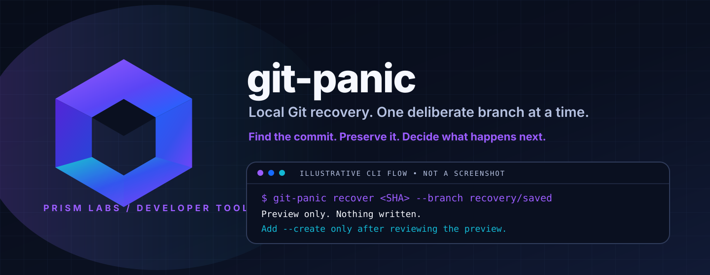
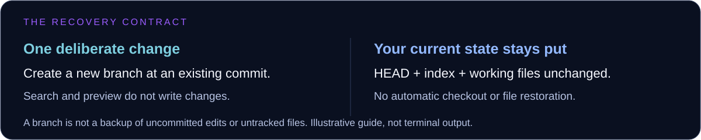
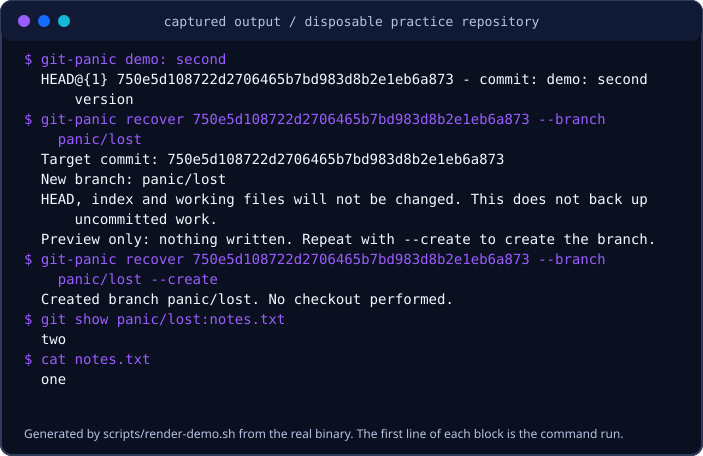
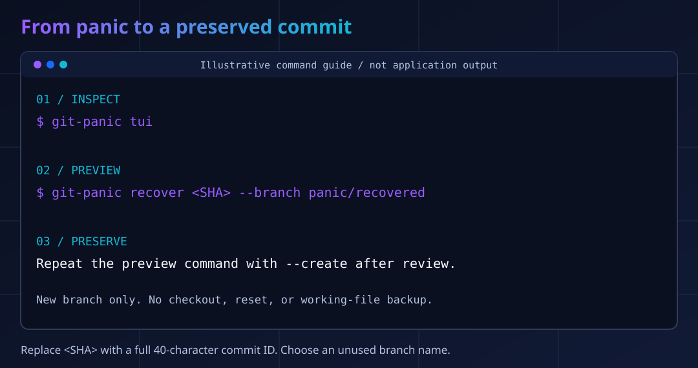
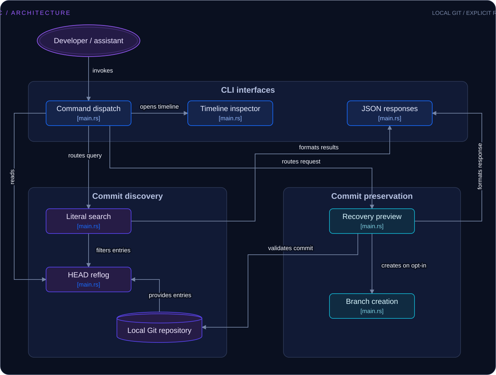

# Prism Git Panic

**`git-panic` is a read-only-first Git recovery CLI written in Rust.**

Part of the Prism Labs developer-tools collection. Find commits that remain available in your local HEAD reflog, inspect them, preview a recovery branch, and create that branch only when you explicitly pass `--create`.

**Find the commit. Preserve it. Decide what happens next.**

[](https://github.com/prismai-labs/prism-git-panic/actions/workflows/ci.yml)
[](LICENSE)
[](Cargo.toml)

[Quick start](#quick-start) · [Installation](#installation) · [Commands](#commands) · [Safety](#safety-contract) · [Architecture](#architecture) · [User guide](docs/guide.md) · [Contributing](CONTRIBUTING.md)

> **Important:** `git-panic` can preserve commits that are still available locally. It cannot recover edits Git never stored, expired reflog entries, or pruned objects. It is not an automatic undo button or a backup tool.

## Safety contract

| Action | Effect |
| --- | --- |
| Open the timeline | Read-only. Reads the local HEAD reflog. |
| Search reflog messages | Read-only. No repository changes. |
| Preview recovery | Validates the commit and proposed branch name without writing. |
| Recover with `--create` | Creates one new branch reference. Does not check out the branch or alter the working tree. |

The recovery branch name must be unused. Preview does not reserve that name, so another process can create it before the explicit write.

## Why Prism Git Panic?

After a reset or rebase, a commit may still exist locally even when your branch no longer points to it. Finding that commit under pressure can be confusing. `git-panic` keeps the recovery flow narrow and reviewable:

1. Inspect or search the local HEAD reflog.
2. Review the full commit SHA.
3. Preview creating a recovery branch.
4. Explicitly create that branch when ready.

Search and preview are read-only. Creating a recovery branch does not switch branches or change HEAD, the index, or working files.

## Features

- **Literal search:** find reflog messages with case-insensitive text.
- **Read-only timeline:** browse entries in an interactive terminal.
- **Preview first:** validate the commit and proposed branch name before writing.
- **Explicit preservation:** create a new branch only with `--create`.
- **JSON output:** use search and recovery in scripts.
- **Local operations:** no application API keys, network calls, or remote Git operations.
- **Narrow write boundary:** existing branches are never overwritten.



## Demo



Generated in a disposable practice repository using [scripts/render-demo.sh](scripts/render-demo.sh).

## Installation

### Requirements

- Git.
- Rust 1.88 or newer with Cargo; current stable Rust is recommended.
- A native C compiler and platform build tools for the Git library dependency.
- An interactive terminal for the timeline.

Install Rust using the [official instructions](https://rust-lang.org/tools/install/). The current Git dependency configuration disables SSH/HTTPS support, so OpenSSL development packages are not required by that configuration. Builds may need internet access to download dependencies.

### Linux

On Debian or Ubuntu:

```bash
sudo apt-get update
sudo apt-get install -y git build-essential pkg-config
```

Other distributions need equivalent Git, compiler, and build-tool packages.

### macOS

Install Apple's command-line developer tools if needed:

```bash
xcode-select --install
git --version
```

### Windows

Install Git for Windows, Rust using the MSVC toolchain, and Visual Studio Build Tools with the C++ build tools and Windows SDK. Use PowerShell for the installation commands below.

### Build and install from source

```bash
git clone https://github.com/prismai-labs/prism-git-panic.git
cd prism-git-panic
cargo install --path . --locked
git-panic --version
git-panic --help
```

Cargo's executable directory must be on PATH:

| Platform | Directory |
| --- | --- |
| Linux / macOS | `~/.cargo/bin` |
| Windows | `%USERPROFILE%\.cargo\bin` |

To build without installing:

```bash
cargo build --release --locked
```

The executable is `target/release/git-panic`, or `target\release\git-panic.exe` on Windows. `--locked` uses the committed dependency resolution.

**No prebuilt binary release is currently published.** Build from source using the steps above.

## Quick start

Run `git-panic` inside the repository you want to inspect, not necessarily this source checkout. Reflogs are local, so another clone may not contain the same history. New to reflogs? Start with the [disposable practice exercise](docs/guide.md#practice-without-risking-your-project) before using a recovery workflow on important work.

### 1. Inspect or search

```bash
git-panic
git-panic reset
git-panic "commit: fix"
```

The first command opens the timeline. The other commands search reflog messages. Search is literal and case-insensitive, not a regular expression or a natural-language query. Copy a full 40-character commit SHA from the results, and quit the timeline before running a recovery command.

### 2. Preview preservation

Replace `FULL_40_CHARACTER_SHA` with the actual commit SHA and choose an unused branch name:

```bash
git-panic recover FULL_40_CHARACTER_SHA --branch recovery/saved
```

This validates the target and branch name without writing anything. Preview does not reserve the branch name.

### 3. Create the branch

After reviewing the preview:

```bash
git-panic recover FULL_40_CHARACTER_SHA --branch recovery/saved --create
```

Only the new branch reference is created. There is no checkout, reset, or working-file restoration. Inspecting or integrating files from the recovered branch is a separate decision.



This diagram is a command guide, not captured output.

## Commands

| Command | Purpose |
| --- | --- |
| `git-panic` | Open the read-only timeline. |
| `git-panic tui` | Explicitly open the timeline. |
| `git-panic "query"` | Search local HEAD reflog messages. |
| `git-panic --json "query"` | Return search results as JSON. |
| `git-panic recover <SHA> --branch <name>` | Preview creating a branch. |
| `git-panic recover <SHA> --branch <name> --create` | Create the branch. |
| `git-panic recover <SHA> --branch <name> --json` | Return the recovery result as JSON. |
| `git-panic --help` | Show command-line help. |
| `git-panic --version` | Show the installed version. |

`<SHA>` and `<name>` denote values you supply; do not paste the angle brackets into your shell.

JSON also works with explicit branch creation. Errors use human-readable stderr and a nonzero exit status. A completed search may return no matches; check `match_count` when using JSON.

Recovery requires an available local commit and a valid unused branch name. Abbreviated SHAs, moving references such as `HEAD@{0}`, non-commit objects, and the branch name `HEAD` are rejected. `snapshot --before` is reserved but not implemented.

### Timeline controls

| Key | Action |
| --- | --- |
| Up / Down or `k` / `j` | Select an entry. |
| PageUp / PageDown | Move by ten entries. |
| Home / End | Jump to the newest / oldest entry. |
| `q` or Ctrl-C | Quit. |

The timeline is read-only. It does not restore files.

## Configuration

`git-panic` currently has no application-specific environment variables, configuration file, API keys, or cloud-provider settings.

| Setting | How to control it |
| --- | --- |
| Repository | Run inside the target repository. |
| Search | Supply a literal positional query. |
| JSON output | Add `--json` to search or recovery. |
| Recovery branch | Supply `--branch <name>`. |
| Branch creation | Explicitly add `--create`. |

Standard Git, terminal, and operating-system behavior may still affect repository discovery and execution.

## Safety and limitations

- Only the local HEAD reflog is searched.
- Recovery requires an available local commit and a full 40-character SHA.
- Expired reflogs or pruned objects may make recovery impossible.
- Uncommitted changes and untracked files are not backed up.
- Existing branches are never overwritten.
- The application does not check out, reset, clean, stash, or contact remotes.
- Interrupted Git operations are not completed or aborted.
- Terminal cleanup is best-effort after errors or forced termination.

When using the CLI through a coding assistant, review what repository output the assistant sends to its provider. A local command does not make a cloud-backed assistant session offline.

See the [user guide](docs/guide.md) for examples and limitations.

## Troubleshooting

| Problem | Next step |
| --- | --- |
| `git-panic` not found | Check Cargo's executable directory is on PATH. |
| No Git repository found | Run inside the repository you want to inspect. |
| No matching entries | Try a shorter literal query such as `reset`. |
| Empty reflog | Verify the clone and whether local reflogs exist. |
| Commit unavailable | Check the full SHA and whether the object exists. |
| Branch already exists | Choose a different branch name. |
| Interactive terminal required | Use search or JSON instead of the timeline. |

An empty reflog cannot be fixed by changing the search query.

## Architecture



The architecture diagram illustrates the inspection, search, and recovery workflow. Recovery previews before explicit branch creation.

## Prism AI weekly audit

This repository also contains a separate, read-only scheduled audit of the public [Prism AI](https://github.com/prismai-labs/Prism-Ai) repository. It uses unauthenticated public GitHub reads, writes only its own Actions summary and report artifact, and does not modify Prism AI. See [the audit documentation](docs/prism-ai-audit.md).

## Development

```bash
cargo fmt --all -- --check
cargo test --all-targets --locked
cargo clippy --all-targets --locked -- -D warnings
cargo build --release --locked
cargo package --locked --list
```

CI is configured for Linux, macOS, and Windows, including a separate test/build check for the declared Rust 1.88 minimum. Consult current workflow results rather than assuming every revision passes.

## Contributing

Bug reports, documentation improvements, tests, and focused pull requests are welcome. Read [CONTRIBUTING.md](CONTRIBUTING.md), the [Code of Conduct](CODE_OF_CONDUCT.md), and [SECURITY.md](SECURITY.md) before contributing or reporting a vulnerability.

## Part of Prism Labs

[Prism AI](https://github.com/prismai-labs/Prism-Ai) is the separate research and writing product in the Prism Labs collection. It is not required to use `git-panic`.

## License

[MIT](LICENSE). The original author and copyright attribution in the license are retained.

Third-party dependencies retain their own licenses and notices.
