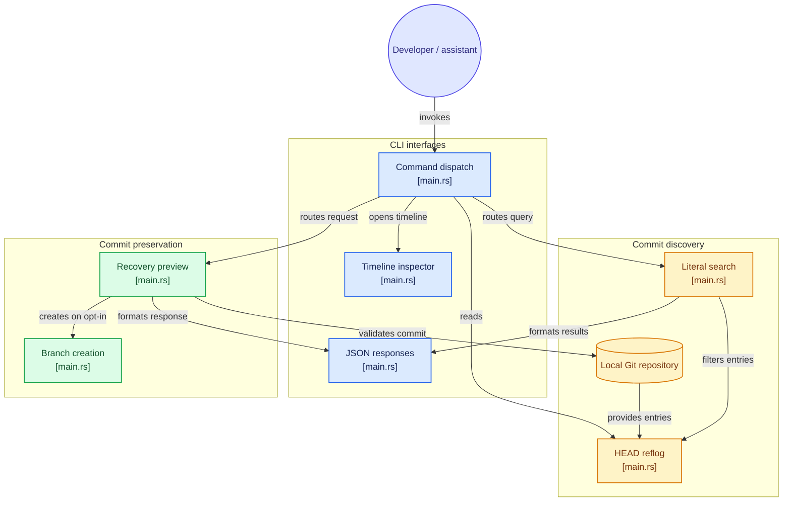

# git-panic


Find an earlier commit. Give it a branch. Decide what happens next.

A local Git recovery helper for developers and shell-capable coding assistants.
The banner is illustrative artwork, not a screenshot.

[Beginner and AI-assistant guide](docs/guide.md) · [Install](#install) · [Quick start](#quick-start) · [Limits](#know-the-limits) · [Contributing](CONTRIBUTING.md)

## How it works, in plain English

Git keeps commits: saved snapshots of tracked files. Its local reflog records
where HEAD, your current Git position, has moved. After a confusing reset or
rebase, a commit you need may still be stored locally even if your current
branch no longer points to it.

git-panic helps you find that commit and give it a new branch name. Creating a
branch does not switch HEAD or replace the files in your working folder. It is
not an automatic undo button and cannot promise recovery of edits Git never saved.

New to Git recovery? Start with the [disposable practice exercise](docs/guide.md#practice-without-risking-your-project).
It teaches the difference between preserving a commit and restoring working files.

## Install

Prerequisites: Git, current stable Rust with Cargo, and a native C compiler with
platform build tools for the vendored libgit2. OpenSSL development files are not
required: git-panic never performs network or remote operations. The TUI
requires an interactive terminal.

```sh
git clone https://github.com/DudeSquad999/git-panic.git
cd git-panic
cargo install --path .
git-panic --help
```

Put Cargo's binary directory on PATH (`~/.cargo/bin`, or
`%USERPROFILE%\.cargo\bin` on Windows). Alternatively build with
`cargo build --release` and use `target/release/git-panic` (`git-panic.exe` on Windows).
The source uses IsTerminal (Rust 1.70+), but dependency requirements may be newer;
no minimum supported version or registry publication is verified here. This
repository now ships a generated Cargo.lock, so use `--locked` for reproducible
builds. Installation, tests and the tutorial below were verified on Linux with
rustc 1.99.1; macOS and Windows checks run in CI but were not exercised locally.

After installation, run the command inside the repository you want to inspect,
not the git-panic source checkout. Another clone may lack the older local reflogs.

## Quick start

```sh
git-panic                 # read-only timeline for a human
git-panic tui             # same timeline
git-panic reset           # messages containing the literal substring "reset"
git-panic "commit: fix"   # quote a search fragment containing spaces
```

Up/Down (or j/k) selects an entry; PageUp/PageDown move by ten entries,
Home/End jump to the newest/oldest, and q or Ctrl-C exits. The inspector shows
the full SHA, reflog position and action message. R is not a restoration
shortcut. Search is case-insensitive literal matching, not AI interpretation or
regex. No matches or an empty reflog produces a distinct message but still exits
successfully. Piping output to `head` or `grep -m` exits cleanly. Use search in
captured shell tools.

## Preview, then preserve


The first image is a command guide, not captured output. The second is real
output, captured by [scripts/render-demo.sh](scripts/render-demo.sh) in a
disposable practice repository (commands in blue, output in white):


Copy a full 40-character SHA from actual history, quit the TUI if using it,
and choose an unused branch name:

```sh
SHA='<paste-full-40-character-commit-SHA>'
git-panic recover "$SHA" --branch panic/recovered
# Review the preview before explicitly creating the branch:
git-panic recover "$SHA" --branch panic/recovered --create
```

This example uses a POSIX shell; the placeholder is not a real SHA. See the
[guide](docs/guide.md) for PowerShell and a complete practice exercise.
Preview writes nothing. Invalid names, existing branches and unavailable/non-commit
objects fail. Preview does not reserve a name. Creation never force-updates an
existing branch and does not check out the commit. Integrating files is a separate decision.

## Use with Claude Code and other coding assistants

Use the installed CLI through the assistant's shell tool. Prefer literal search
and recover preview, not the interactive TUI. No plugin, MCP server, model key,
or automatic permission bypass is supplied by git-panic.

For parsing by a script or assistant, add `--json` to the two noninteractive
commands. It is a small, tested interface, not a general automation framework:

```sh
git-panic --json reset                                  # {"query","match_count","matches":[{"index","oid","message"}]}
git-panic recover "$SHA" --branch panic/recovered --json       # {"action":"preview","commit","branch","created":false}
git-panic recover "$SHA" --branch panic/recovered --create --json
```

A search always exits 0 and reports `match_count`; check that field instead of
assuming success means a match exists. Errors stay human-readable on stderr
with a nonzero exit code. The JSON shape is stable within a version; check
`git-panic --version` before relying on it across releases.

The [AI-assistant guide and copy-paste task](docs/guide.md#use-with-claude-code-or-another-shell-capable-coding-assistant)
show how to confirm the target repository, inspect candidates and stop for human
approval before branch creation. They also explain cloud-output privacy and why
the default human-readable output should not be parsed by unattended tools.

[AGENTS.md](AGENTS.md) guides assistants editing this project;
[CLAUDE.md](CLAUDE.md) imports it for Claude Code. Installing git-panic does not
install those instructions into your other projects. The documented noninteractive
workflow was verified on Linux; loading these instruction files inside an actual
assistant session remains unverified.

## Know the limits

- Only the local HEAD reflog is searched. No stash scanning, other branches'
  reflog scanning, dangling-object search or visual diff view is implemented.
- Unstored edits, expired reflogs and pruned objects may be unrecoverable.
- A branch is not a backup of staged/unstaged edits, untracked files, conflict
  resolutions or interrupted-operation state. Preserve those separately.
- No checkout, reset, clean, stash or remote operation is invoked by the app.
  Interrupted merges/rebases/cherry-picks/reverts are not finished or aborted.
- snapshot --before is reserved but unimplemented and reports failure.
- Terminal cleanup is best-effort, not guaranteed after aborts or forced stops.
- Local application execution does not make a cloud-backed AI session offline.
  Review what output your assistant sends to its provider. Builds may use the network.

## Troubleshooting and development

Command not found? Check PATH in the actual terminal or assistant environment.
No repository? Check the working directory. No matches? Try a shorter literal
fragment. Commit unavailable? Verify the full SHA and clone. Branch exists? Choose
a different name; do not force-update it. A redirected TUI needs an interactive
terminal, so use search instead. On POSIX systems, try stty sane then reset if a
forced stop leaves the terminal altered.

Read the [full guide](docs/guide.md#when-something-fails) and
[CONTRIBUTING.md](CONTRIBUTING.md) for checks and remaining validation. No blanket
installation, security-audit, release-readiness or AI compatibility guarantee is made.

The project grew out of the maintainer's recovery experience while building
[Prism-AI](https://github.com/DudeSquad999/Prism-Ai).

## Licensing status

The manifest declares MIT, but the inspected repository has no LICENSE file.
The declaration is preserved without inventing a holder or license text. The
maintainer needs to resolve the missing file before users rely on distribution terms.

## Architecture

[](https://gitdiagram.com/dudesquad999/git-panic?utm_source=readme&utm_medium=picture)

[](https://gitdiagram.com/dudesquad999/git-panic?utm_source=readme&utm_medium=badge)

<details>
<summary>View the Mermaid architecture diagram</summary>



</details>

Generated with [GitDiagram](https://gitdiagram.com/dudesquad999/git-panic).
