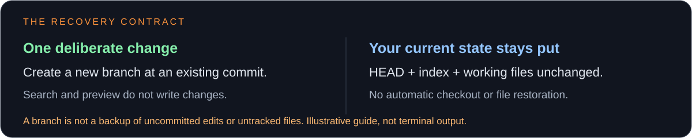
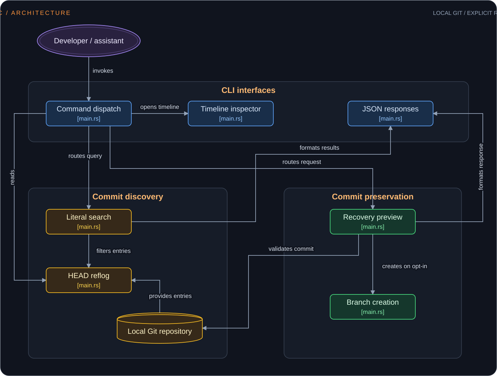

Find the commit. Preserve it. Decide what happens next.

A local Git recovery CLI for browsing reflogs and preserving available commits
on new branches—without switching branches or changing your working files.

[](https://github.com/DudeSquad999/git-panic/actions/workflows/ci.yml)
[](LICENSE)
[](Cargo.toml)

[Quick start](#quick-start) ·
[Installation](#installation) ·
[Commands](#commands) ·
[Architecture](#architecture) ·
[User guide](docs/guide.md) ·
[Contributing](CONTRIBUTING.md) · [Code of Conduct](CODE_OF_CONDUCT.md)

> Early-stage software. git-panic preserves available commits; it cannot recover
> edits Git never stored. It is not an automatic undo button or a backup tool.

## Why This Project?

After a reset or rebase, a commit may still exist locally even when your branch
no longer points to it. Finding that commit under pressure can be confusing.

git-panic provides a focused workflow:

1. Inspect or search the local HEAD reflog.
2. Review the full commit SHA.
3. Preview creating a recovery branch.
4. Explicitly create that branch when ready.

Search and preview are read-only. Creating a recovery branch does not switch
branches or change HEAD, the index, or working files.

## Features

- 🔎 Literal search — Find reflog messages using case-insensitive text.
- 🖥️ Read-only timeline — Browse entries in an interactive terminal.
- 👀 Preview first — Validate the commit and branch name before writing.
- 🌿 Explicit preservation — Create a new branch only with `--create`.
- 🧾 JSON output — Use search and recovery in scripts.
- 🔒 Local operations — No application API keys or remote Git operations.
- 🛡️ Narrow write boundary — Existing branches are never overwritten.



## Demo


Generated in a disposable practice repository using
[scripts/render-demo.sh](scripts/render-demo.sh).

## Installation

### Requirements

- Git.
- Rust 1.88 or newer with Cargo; current stable Rust is recommended.
- A native C compiler and platform build tools for the Git library dependency.
- An interactive terminal for the timeline.

Install Rust using the [official instructions](https://rust-lang.org/tools/install/).

The current Git dependency configuration disables SSH/HTTPS support.
OpenSSL development packages are not required by that configuration.

Builds may need internet access to download dependencies. Installation
instructions should be checked against the revision you are using.

### Linux

On Debian or Ubuntu:

```bash
sudo apt-get update
sudo apt-get install -y git build-essential pkg-config
```

Other distributions need equivalent Git, compiler, and build-tool packages.

### macOS

Install Apple's command-line developer tools if needed:

```bash
xcode-select --install
```

Verify that Git is available:

```bash
git --version
```

### Windows

Install:

1. Git for Windows.
2. Rust using the MSVC toolchain.
3. Visual Studio Build Tools with the C++ build tools and Windows SDK.

Use PowerShell for the installation commands below.

### Build and install from source

```bash
git clone https://github.com/DudeSquad999/git-panic.git
cd git-panic
cargo install --path . --locked
git-panic --version
git-panic --help
```

Cargo's executable directory must be on PATH:

| Platform | Directory |
| --- | --- |
| Linux / macOS | `~/.cargo/bin` |
| Windows | `%USERPROFILE%\.cargo\bin` |

To build without installing:

```bash
cargo build --release --locked
```

The executable is `target/release/git-panic`, or
`target\release\git-panic.exe` on Windows.

`--locked` uses the committed dependency resolution. The package version
shown above comes from Cargo.toml; it does not establish a published release.

## Quick Start

Run git-panic inside the repository you want to inspect—not necessarily the
git-panic source checkout.

Reflogs are local: another clone may not contain the same history.

### 1. Inspect or search

```bash
git-panic
git-panic reset
git-panic "commit: fix"
```

The first command opens the timeline. The other commands search reflog
messages.

Search is literal and case-insensitive—not a regular expression or a
natural-language query.

Copy a full 40-character commit SHA from the results. Quit the timeline
before running a recovery command.

### 2. Preview preservation

In the following examples, replace `FULL_40_CHARACTER_SHA` with the actual
commit SHA. Choose an unused branch name.

```bash
git-panic recover FULL_40_CHARACTER_SHA --branch panic/recovered
```

This validates the target and branch name without writing anything.
Preview does not reserve the branch name.

### 3. Create the branch

After reviewing the preview:

```bash
git-panic recover FULL_40_CHARACTER_SHA --branch panic/recovered --create
```

Only the new branch reference is created. There is no checkout, reset, or
working-file restoration.

Inspecting or integrating files from the recovered branch is a separate
decision.

Start with the [disposable practice exercise](docs/guide.md#practice-without-risking-your-project)
before using a recovery workflow on important work.


This diagram is a command guide, not captured output.

## Commands

| Command | Purpose |
| --- | --- |
| `git-panic` | Open the read-only timeline. |
| `git-panic tui` | Explicitly open the timeline. |
| `git-panic "query"` | Search local HEAD reflog messages. |
| `git-panic --json "query"` | Return search results as JSON. |
| `git-panic recover <SHA> --branch <name>` | Preview creating a branch. |
| `git-panic recover <SHA> --branch <name> --create` | Create the branch. |
| `git-panic recover <SHA> --branch <name> --json` | Return the preview as JSON. |
| `git-panic --help` | Show command-line help. |
| `git-panic --version` | Show the installed version. |

`<SHA>` and `<name>` denote values you supply; do not paste the angle
brackets into your shell.

JSON also works with explicit branch creation. Errors use human-readable
stderr and a nonzero exit status. A completed search may return no matches;
check `match_count` when using JSON.

Recovery requires an available local commit and a valid unused branch name.
Abbreviated SHAs, moving references such as `HEAD@{0}`, non-commit objects,
and the branch name `HEAD` are rejected.

`snapshot --before` is reserved but not implemented.

### Timeline controls

| Key | Action |
| --- | --- |
| Up / Down or `k` / `j` | Select an entry. |
| PageUp / PageDown | Move by ten entries. |
| Home / End | Jump to the newest / oldest entry. |
| `q` or Ctrl-C | Quit. |

The timeline is read-only. It does not restore files.

## Configuration

git-panic currently has no application-specific environment variables,
configuration file, API keys, or cloud-provider settings.

| Setting | How to control it |
| --- | --- |
| Repository | Run from inside the target repository. |
| Search | Supply a literal positional query. |
| JSON output | Add `--json` to search or recovery. |
| Recovery branch | Supply `--branch <name>`. |
| Branch creation | Explicitly add `--create`. |

Standard Git, terminal, and operating-system behavior may still affect
repository discovery and execution.

## Safety and Limitations

- Only the local HEAD reflog is searched.
- Recovery requires an available local commit and a full 40-character SHA.
- Expired reflogs or pruned objects may make recovery impossible.
- Uncommitted changes and untracked files are not backed up.
- Existing branches are never overwritten.
- The application does not check out, reset, clean, stash, or contact remotes.
- Interrupted Git operations are not completed or aborted.
- Terminal cleanup is best-effort after errors or forced termination.

When using the CLI through a coding assistant, review what repository
output the assistant sends to its provider. A local command does not make
a cloud-backed assistant session offline.

See the [user guide](docs/guide.md) for examples and limitations.

## Troubleshooting

| Problem | Next step |
| --- | --- |
| `git-panic` not found | Check Cargo's executable directory is on PATH. |
| No Git repository found | Run inside the repository you want to inspect. |
| No matching entries | Try a shorter literal query such as `reset`. |
| Empty reflog | Verify the clone and whether local reflogs exist. |
| Commit unavailable | Check the full SHA and whether the object exists. |
| Branch already exists | Choose a different branch name. |
| Interactive terminal required | Use search or JSON instead of the timeline. |

An empty reflog cannot be fixed by changing the search query.

## Architecture



The architecture diagram illustrates the inspection, search, and recovery
workflow. Recovery previews before explicit branch creation.

## Development

```bash
cargo fmt --all -- --check
cargo test --all-targets --locked
cargo clippy --all-targets --locked -- -D warnings
cargo build --release --locked
cargo package --locked --list
```

CI is configured for Linux, macOS, and Windows. Consult current workflow
results rather than assuming every revision passes.

## Contributing

Bug reports, documentation improvements, tests, and focused pull requests
are welcome.

Read [CONTRIBUTING.md](CONTRIBUTING.md) and our
[Code of Conduct](CODE_OF_CONDUCT.md).

For suspected vulnerabilities, consult [SECURITY.md](SECURITY.md) before
posting details publicly.

## Related Project

[](https://github.com/DudeSquad999/Prism-Ai)

[Prism AI](https://github.com/DudeSquad999/Prism-Ai) is the creator's separate
research and writing project. It is not required to use git-panic.

## License

[MIT](LICENSE). Copyright (c) 2026 DudeSquad999.

Third-party dependencies retain their own licenses and notices.
