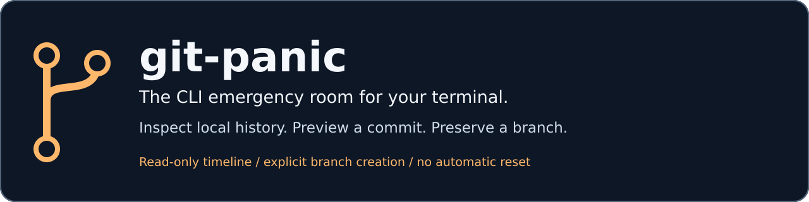

# git-panic



Find the commit. Keep your cool. Decide what happens next.

A local Git reflog inspector for developers recovering from confusing resets,
rebases, or detached-HEAD sessions. Browse reference movements, inspect full
commit IDs, and explicitly preserve a commit on a new branch.

[Install](#install-from-source) · [Quick start](#quick-start) · [Recovery workflow](#preserve-a-commit) · [Safety](#safety-and-limits) · [Troubleshooting](#troubleshooting) · [Contributing](CONTRIBUTING.md)

## At a glance

| Inspect | Find | Preserve |
| --- | --- | --- |
| Read-only terminal timeline of the local HEAD reflog. | Case-insensitive literal search through reflog messages. | Preview a full commit SHA; create a new branch only with `--create`. |

No checkout, reset, stash, or remote operation is invoked by the application.
Building and installing dependencies may require network access.

## Install from source

You need Git, a current stable Rust toolchain with Cargo, and a native C compiler
with platform build tools for git2/libgit2 dependencies. The TUI requires
interactive stdin and stdout. Registry publication has not been verified.

```sh
git clone https://github.com/DudeSquad999/git-panic.git
cd git-panic
cargo install --path .
git-panic --help
```

Ensure Cargo's binary directory is on PATH: normally `~/.cargo/bin`, or
`%USERPROFILE%\.cargo\bin` on Windows. Prefer a local build? Run
`cargo build --release` and use the binary in `target/release`.

The source uses IsTerminal (Rust 1.70+), but resolved dependencies may require a
newer compiler. No minimum supported Rust version has been verified.

## Quick start

Run inside the repository whose local history you need, including from a
subdirectory. Another clone may not contain the older reflogs you need.

```sh
git-panic                 # open the read-only timeline
git-panic tui             # same interface
git-panic reset           # find messages containing "reset"
git-panic "commit: fix"   # literal search; quote spaces
```

Search is not natural-language interpretation or regular-expression matching.
Use a fragment of an actual reflog message. Search prints full commit SHAs and
replaces displayed control characters with spaces. No-match searches succeed
with an explanatory message; use search for piping and noninteractive sessions.

| Key | Action |
| --- | --- |
| Up / Down | Select an entry; the list scrolls with the selection. |
| `q` / Ctrl-C | Exit the inspector. |

The inspector shows the full commit SHA, reflog position, and action message.
It does not modify the repository. `R` is not a file-restoration shortcut.

## Preserve a commit


This is an illustrative command guide, not captured application output. Every
command is also available as selectable text below. No real screenshot or
recording has been captured in the editing environment.

### 1. Inspect the local timeline

```sh
git-panic tui
```

Select the relevant entry and copy its full 40-character commit SHA. Quit the
inspector before running the next commands.

### 2. Preview the exact commit and branch

Replace the placeholder and choose an unused branch name. POSIX-shell example:

```sh
SHA='<paste-full-40-character-commit-SHA>'
git-panic recover "$SHA" --branch panic/recovered
```

Nothing is written by preview. A full SHA avoids relying on moving `HEAD@{n}`
positions. Invalid names, unavailable or non-commit objects, and existing
branches are errors, including during preview.

### 3. Create the branch only after reviewing

```sh
git-panic recover "$SHA" --branch panic/recovered --create
```

The placeholder is not a real commit ID. In PowerShell, assign
`$sha = '<paste-full-40-character-commit-SHA>'` and use `$sha` in those commands.

Creation preserves a commit reference without switching HEAD. Preview does not
reserve a branch name: a later conflict fails rather than overwriting. Review
the commit and decide separately whether and how to integrate it.

## Safety and limits

A reflog records local reference movements, not every file edit. This is a
commit-discovery and branch-preservation tool, not a working-directory backup.

- No recovery of edits Git never stored, expired/pruned objects, or reflogs
  absent from this clone is promised.
- No stash scanning, other branches' reflog scanning, dangling-object search,
  visual diff view, or time-based snapshot lookup is implemented.
- Creating a branch does not back up the index, staged/unstaged edits,
  untracked files, conflict resolutions, or interrupted-operation state.
- Interrupted merges, rebases, cherry-picks, and reverts are not resolved or
  aborted. Inspect `git status` and preserve files separately before subsequent
  Git actions. Do not discard or auto-stash work just because HEAD is detached.
- No automatic file restoration or reversibility is promised. Terminal cleanup
  is best-effort and cannot guarantee recovery after aborts or forced termination.

## Troubleshooting

| Symptom | What to check |
| --- | --- |
| No repository found | Run inside the intended Git repository. |
| No HEAD reflog entries | This may be a new repository, another clone, or disabled/expired reflogs. |
| No search matches | Try part of an actual message such as `reset` or `commit:`. |
| Commit unavailable | Verify the full SHA and clone; the object may have been pruned. |
| Branch already exists | Choose a new name. Existing branches are not force-updated. |
| TUI requires a terminal | Use literal search for redirected output or CI. |
| `snapshot --before` fails | The command is reserved but unimplemented; it reports failure. |
| Native dependency build fails | Check the compiler/platform prerequisites in the Cargo error. |
| Terminal remains altered after a forced stop | On POSIX shells, try `stty sane`, then `reset`. |

## Development and project status

Read [CONTRIBUTING.md](CONTRIBUTING.md) for local checks, architecture, test
isolation, and remaining manual validation. No blanket cross-platform installation,
security-audit, or release-readiness claim is made here. A real terminal recording
requires a compiled app and a disposable demonstration repository.

The project grew out of the maintainer's recovery experience while building
[Prism-AI](https://github.com/DudeSquad999/Prism-Ai). The artwork in this README
is original static project artwork, not a simulated application result.

## Licensing status

The existing manifest declares MIT. The inspected repository did not include a
LICENSE file. That declaration is preserved without inventing a copyright holder
or adding unauthorized license text. The maintainer needs to resolve the missing
file before users rely on distribution terms.
