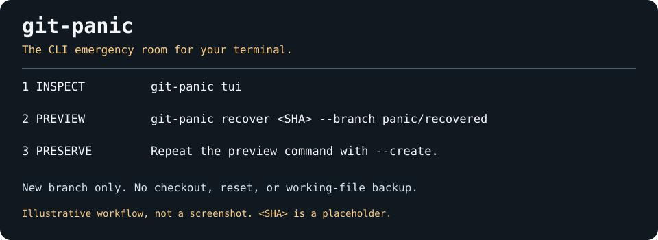

# git-panic

The CLI emergency room for your terminal. Inspect local Git history, find a commit,
and preserve it on a new branch before deciding what to do next.



This diagram is illustrative, not captured application output. The project grew
out of the maintainer's recovery experience while building
[Prism-AI](https://github.com/DudeSquad999/Prism-Ai).

## What it does

- Browse local HEAD reflog entries in a read-only terminal interface.
- Inspect full commit SHAs, reflog positions and action messages.
- Search messages with a case-insensitive literal substring such as `reset`.
- Preview preserving a commit on a new branch; create it only with `--create`.

Application code invokes no network or remote operation. Building/installing
dependencies may require network access. No performance or publication claims
are implied.

## Before you start

A reflog records local reference movements, not every file edit. This tool cannot
recover edits Git never stored, expired/pruned objects, or reflogs absent from
this clone. It does not scan stashes, other branches' reflogs or unreachable
objects, and it does not show visual diffs.

The TUI is read-only. Recovery writes a new branch reference only: no checkout,
reset, index update, stash, remote access or working-file backup. Existing
branches are never force-updated. Detached HEAD or a dirty tree is not a reason
to discard or automatically stash work.

Interrupted merges, rebases, cherry-picks and reverts are not resolved or aborted.
Inspect `git status` and preserve files separately before subsequent Git actions.
A branch is not a backup of the index, conflict resolutions, untracked files or
operation state. No automatic file restoration or reversibility is promised.

## Install from source

Prerequisites: Git, current stable Rust with Cargo, a native C compiler and
platform build tools for git2/libgit2 dependencies. The source uses IsTerminal
(Rust 1.70+), but resolved dependencies may require newer Rust; an MSRV has not
been verified. Interactive stdin/stdout are required for the TUI.

```sh
git clone https://github.com/DudeSquad999/git-panic.git
cd git-panic
cargo install --path .
git-panic --help
```

Cargo's binary directory must be on PATH: normally `~/.cargo/bin`, or
`%USERPROFILE%\.cargo\bin` on Windows. Alternatively run `cargo build --release`
and use the binary in `target/release`. Registry publication is unverified; use
source installation. The new changes require CI and manual testing before release.

## Quick start

Run inside the repository whose local history you need, including from a
subdirectory. Another clone may not contain the relevant older reflogs.

```sh
git-panic                 # read-only timeline
git-panic tui             # same interface
git-panic reset           # literal substring search
git-panic "commit: fix"   # quote spaces
```

Up/Down selects an entry; the list scrolls with the selection. `q` or Ctrl-C
exits. The inspector and search provide full SHAs. `R` does not restore files.
For piping/noninteractive use, choose search. Displayed control characters are
replaced with spaces. No-match searches succeed with an explanatory message.

## Preserve a commit without checking it out

Copy the full 40-character SHA from the inspector or search. Replace the
placeholder and choose an unused branch name in this POSIX-shell example:

```sh
SHA='<paste-full-40-character-commit-SHA>'
git-panic recover "$SHA" --branch panic/recovered
# Preview only: review target and branch before continuing.
git-panic recover "$SHA" --branch panic/recovered --create
```

For PowerShell, assign `$sha = '<paste-full-40-character-commit-SHA>'` and use
`$sha` in those commands. These placeholders are not real commit IDs.

A full SHA avoids relying on moving `HEAD@{n}` positions. Unavailable objects,
non-commit objects, invalid names and existing branches are errors, including
during preview. Preview does not reserve a branch name: a later name conflict
fails rather than overwriting. Creation does not switch HEAD. Review the commit
and decide separately whether/how to integrate it.

## Troubleshooting

| Symptom | Explanation / next step |
| --- | --- |
| No repository found | Run inside the intended Git repository. |
| No HEAD reflog entries | New repository, disabled/expired reflogs or another clone; there may be nothing to inspect. |
| No search matches | Search is not natural-language interpretation; try part of an actual message such as `reset`. |
| Commit unavailable | Verify full SHA and clone; the object may have been pruned. |
| Branch exists | Choose another name; no branch is force-updated. |
| TUI requires a terminal | Use literal search for redirected output or CI. |
| `snapshot --before` fails | Reserved but unimplemented; failure replaces the former no-op success. |
| Native build fails | Check compiler/platform prerequisites in the Cargo error. Cross-platform installation has not been verified. |
| Terminal remains altered after forced termination | On POSIX shells, try `stty sane` then `reset`. Cleanup cannot guarantee recovery after aborts or killed processes. |

## Development and licensing status

See [CONTRIBUTING.md](CONTRIBUTING.md) for checks, architecture, testing and
remaining validation. No successful CI or test result is claimed by this README.

The existing manifest declares MIT. The inspected baseline did not include a
LICENSE file. This pass preserves the declaration without choosing a copyright
holder or adding unauthorized license text. The maintainer needs to resolve
the missing file before users rely on distribution terms.
