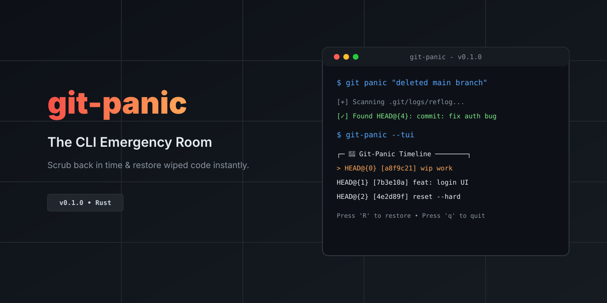
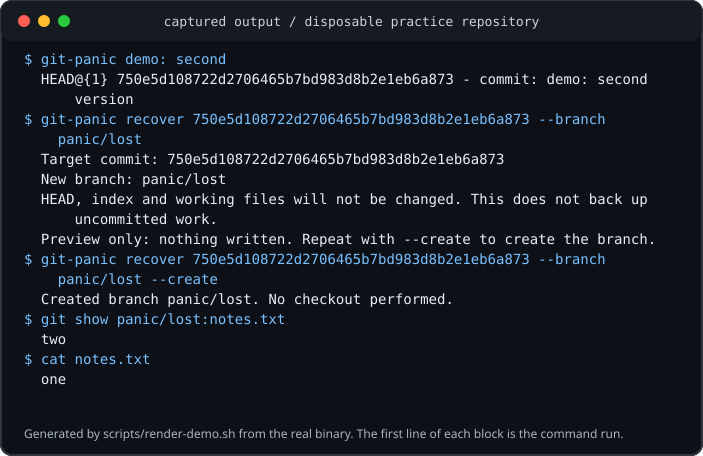
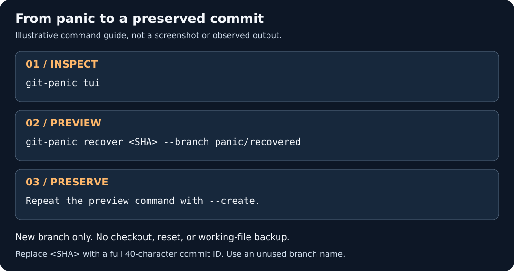
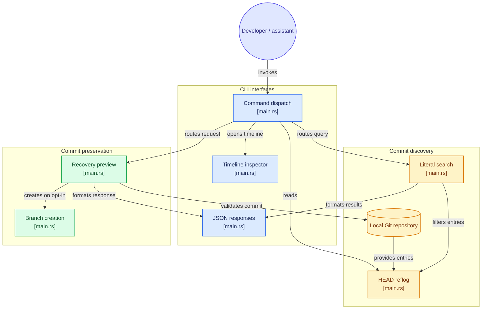

# git-panic



Find an earlier commit. Give it a branch. Decide what happens next.

I'm Aidan, the creator of git-panic and [Prism AI](https://github.com/DudeSquad999/Prism-Ai). I started this project after dealing with Git recovery while building Prism. git-panic is a local Git recovery CLI written in Rust: it helps you find an earlier commit and preserve it on a new branch without switching branches or changing working files.

[Install](#installation) · [Quick start](#quick-start) · [Commands](#command-reference) · [Beginner guide](docs/guide.md) · [Architecture](#architecture) · [About Prism AI](#my-other-project-prism-ai)

## Why I built it

Git recovery can be confusing when you're trying to figure out what happened to your work. I built git-panic around a small workflow: inspect the history, review a commit, and explicitly choose whether to give it a new branch.

After a reset or rebase, a commit may still exist locally even when your branch no longer points to it. Git's HEAD reflog records where your current Git position has moved. git-panic makes those entries easier to browse and search.

I want to be clear about what it does: this is not an automatic undo button. It preserves existing commits, not edits Git never saved. A recovery branch does not restore working files or back up uncommitted work.

## See it in action



This session was captured with [scripts/render-demo.sh](scripts/render-demo.sh) in a disposable practice repository. Commands are blue; output is white. The banner at the top is artwork, not a screenshot.

## What it does

| Feature | What you get |
| :--- | :--- |
| Read-only timeline | Browse HEAD reflog entries and inspect full commit SHAs. |
| Literal search | Filter reflog messages with case-insensitive text. |
| Preview first | Validate a commit and unused branch name without writing changes. |
| Explicit branch creation | Add `--create` only after reviewing the target. Existing branches are never overwritten. |
| JSON output | Use search and recovery from scripts or shell-capable coding assistants. |
| Local Git operations | No checkout, reset, clean, stash, or remote operations. |

## Installation

You need Git, current stable Rust with Cargo, and a native C compiler with platform build tools for vendored libgit2. OpenSSL development files are not required. The timeline needs an interactive terminal.

```sh
git clone https://github.com/DudeSquad999/git-panic.git
cd git-panic
cargo install --path . --locked
git-panic --help
```

Make sure Cargo's binary directory is on PATH:

| Platform | Directory |
| :--- | :--- |
| Linux / macOS | `~/.cargo/bin` |
| Windows | `%USERPROFILE%\.cargo\bin` |

Alternatively, run `cargo build --release --locked` and use `target/release/git-panic` (`git-panic.exe` on Windows).

The repository includes `Cargo.lock`; `--locked` uses the locked dependency resolution. The source uses `IsTerminal` from Rust 1.70+, but dependencies may require a newer compiler. I haven't established a minimum supported Rust version or verified a registry publication.

The previous documented installation and tutorial checks used Linux with rustc 1.99.1. macOS and Windows checks are configured in CI, but were not exercised in that local validation. Builds may need internet access.

## Quick start

After installation, change into the repository you want to inspect, not the git-panic source checkout. Another clone may not have the same local reflog.

### 1. Find a commit

```sh
git-panic                 # Open the read-only timeline
git-panic reset           # Search messages containing "reset"
git-panic "commit: fix"   # Search a phrase containing spaces
```

Search is literal and case-insensitive. It does not interpret natural language or regular expressions. Copy the full 40-character SHA from a result. Quit the timeline before running recovery commands.

### 2. Preview preservation

This example uses a POSIX shell. Replace the placeholder with an actual commit SHA and choose an unused branch name.

```sh
SHA='<paste-full-40-character-commit-SHA>'
git-panic recover "$SHA" --branch panic/recovered
```

Preview validates the commit and branch name. It writes nothing and does not reserve the name.

### 3. Create the branch when ready

Review the preview before explicitly opting in:

```sh
git-panic recover "$SHA" --branch panic/recovered --create
```

Only the new branch reference is created. HEAD, the index, and working files stay unchanged. Inspecting or integrating files from that branch is a separate decision.

If you're new to recovery, I recommend starting with the [disposable practice exercise](docs/guide.md#practice-without-risking-your-project). The [full guide](docs/guide.md) includes PowerShell examples.

## Command reference

| Command | Behavior |
| :--- | :--- |
| `git-panic` or `git-panic tui` | Open the read-only HEAD reflog timeline. |
| `git-panic "query"` | Search HEAD reflog messages for a literal substring. |
| `git-panic --json "query"` | Return search results as JSON. |
| `git-panic recover <SHA> --branch <name>` | Preview preserving a commit on a new branch. |
| `git-panic recover <SHA> --branch <name> --create` | Explicitly create that branch without checking it out. |
| `git-panic recover <SHA> --branch <name> --json` | Return the recovery preview as JSON; also works with `--create`. |
| `git-panic --help` / `git-panic --version` | Show help or version information. |

`recover` requires a full 40-character commit SHA, an available local commit, and a valid unused branch name. Abbreviated SHAs, moving references such as `HEAD@{0}`, non-commit objects, and the branch name `HEAD` are rejected.

`snapshot --before` is reserved but not implemented. It reports failure and is not a recovery option.

### Timeline controls

| Key | Action |
| :--- | :--- |
| Up / Down or `k` / `j` | Select an entry. |
| PageUp / PageDown | Move by ten entries. |
| Home / End | Jump to the newest / oldest entry. |
| `q` or Ctrl-C | Exit. |

The inspector shows the full SHA, reflog position, and action message. It is read-only. `R` does not restore anything. Use literal search instead of the TUI in redirected or captured shell tools. Search output can be piped to tools such as `head` or `grep -m`.

## Scripts and coding assistants

You can use the installed CLI through an assistant's shell tool. I haven't packaged git-panic as a plugin or MCP server. It doesn't need a model key or bypass permission prompts.

```sh
git-panic --json reset
git-panic recover "$SHA" --branch panic/recovered --json
```

Search JSON includes `tool`, `query`, `match_count`, and `matches`. Each match contains `index`, `oid`, and `message`. Recovery JSON includes `tool`, `action`, `created`, `commit`, and `branch`.

- A completed search exits 0 even with no matches. Check `match_count`.
- Errors use human-readable stderr and a nonzero exit code.
- JSON is available for search and recovery, not the interactive timeline.
- The documented JSON shape is stable within a version. Check `git-panic --version` before relying on it across releases.
- Confirm the repository and target commit, review the preview, and ask for human approval before adding `--create`.
- Review what shell output a cloud-backed assistant sends to its provider. A local CLI does not make the assistant session offline.

I've included an [AI-assistant guide and copy-paste task](docs/guide.md#use-with-claude-code-or-another-shell-capable-coding-assistant). Don't parse the default human-readable output in unattended tools.

[AGENTS.md](AGENTS.md) guides assistants editing this project; [CLAUDE.md](CLAUDE.md) imports it for Claude Code. Installing git-panic does not install those instructions into other repositories. The documented noninteractive workflow was previously verified on Linux; instruction-file loading in an actual assistant session remains unverified.

## Safety and limitations

I keep the recovery behavior narrow. Please read these limits before relying on the tool:

- Only the local HEAD reflog is searched. There is no stash scanning, other branches' reflog scanning, dangling-object search, or visual diff view.
- Unstored edits, expired reflogs, and pruned objects may be unrecoverable.
- A branch is not a backup of staged or unstaged edits, untracked files, conflict resolutions, or interrupted-operation state. Preserve those separately.
- The app does not check out commits, reset files, clean files, stash changes, or contact remotes.
- Interrupted merges, rebases, cherry-picks, and reverts are not finished or aborted.
- Terminal cleanup is best-effort and cannot be guaranteed after aborts or forced stops.



This image is a command guide, not captured output. The recorded terminal session appears near the top of this README.

## Troubleshooting

| Symptom | What to check |
| :--- | :--- |
| Command not found | Confirm Cargo's binary directory is on PATH in the terminal or assistant environment actually running the command. |
| No Git repository found | Run inside the repository you want to inspect. |
| No matching entries | Try a shorter literal fragment such as `reset` or `commit`. |
| No local HEAD reflog entries | Check the repository and clone. Its reflog may be empty, disabled, or expired; changing the query cannot create entries. |
| Commit unavailable | Verify the full SHA and clone. The object may have been pruned or may not be a commit. |
| Branch already exists | Choose a different name. Existing branches are never overwritten. |
| TUI needs an interactive terminal | Use literal search or JSON in captured or redirected tools. |
| Terminal looks wrong after a forced stop | On POSIX systems, try `stty sane`, then `reset`. |

See the [troubleshooting guide](docs/guide.md#when-something-fails) for more detail.

## Architecture

[](https://gitdiagram.com/dudesquad999/git-panic?utm_source=readme&utm_medium=picture)

[](https://gitdiagram.com/dudesquad999/git-panic?utm_source=readme&utm_medium=badge)

<details>
<summary>View the Mermaid architecture diagram</summary>



</details>

Generated with [GitDiagram](https://gitdiagram.com/dudesquad999/git-panic).

## My other project: Prism AI

[Prism AI](https://github.com/DudeSquad999/Prism-Ai) is my Windows research and writing workspace. I'm building it to make the path from a research question to a finished document easier to manage, with a choice of local or cloud AI and review of AI-proposed edits.

It has two companion applications:

| Application | What it's for |
| :--- | :--- |
| Prism Chat | Organizing research projects, conversations, source material, and Markdown notes. |
| Prism Studio | Writing LaTeX papers and presentations, managing BibTeX references, and compiling PDFs with Tectonic. |

You can use local models through Ollama or configure your own API key for Google Gemini, Anthropic, or OpenAI. Chat and Studio need to be configured separately. Local inference runs on your computer after setup, but not every feature works offline. Content included in cloud requests goes to your configured provider.

There's also a [browser workspace](https://dudesquad999.github.io/Prism-Ai/) you can explore without installing the Windows apps. It supports projects, conversations, Markdown drafts, tasks, Perspectives, and project import and export. You can connect it to Ollama running on your computer for live chat. Without Ollama, Chat uses labeled sample responses. It doesn't include live web search, citation verification, or document uploads, and it doesn't replace the Windows applications.

Prism is still early-stage software. Check important AI-generated claims and citations, review proposed edits, and keep backups of important work. The public repository contains the browser workspace, documentation, automation, and project records; it does not currently include the complete source for the packaged Windows applications.

Building Prism is what led me to git-panic. They're separate projects: Prism helps with research and writing, while git-panic helps preserve existing Git commits when development gets messy. You don't need Prism to use git-panic, and git-panic isn't a Prism plugin.

[Explore Prism AI](https://github.com/DudeSquad999/Prism-Ai) · [Windows releases](https://github.com/DudeSquad999/Prism-Ai/releases) · [Installation guide](https://github.com/DudeSquad999/Prism-Ai/blob/Main/docs/installation.md) · [Try the browser workspace](https://dudesquad999.github.io/Prism-Ai/)

## Feedback, contributing, and security

If something breaks or a step is confusing, I'd like to hear about it. [Open an issue](https://github.com/DudeSquad999/git-panic/issues) with the command, version, what you expected, and what happened. Remove credentials, private paths, and sensitive repository content before sharing logs.

Read [CONTRIBUTING.md](CONTRIBUTING.md) for development checks and validation guidance, and [SECURITY.md](SECURITY.md) for the security policy.

I'm not claiming a blanket installation, security-audit, release-readiness, or AI compatibility guarantee. The limitations above are part of the documentation, not fine print.

## Licensing status

The manifest declares MIT, but I still need to add the missing `LICENSE` file and resolve the repository's licensing documentation. Until then, don't rely on the manifest declaration alone for distribution terms.
